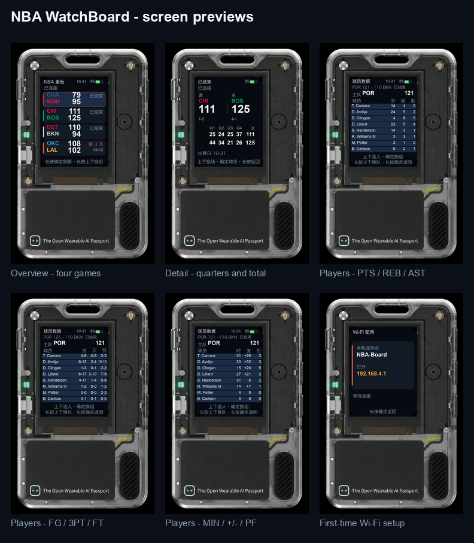
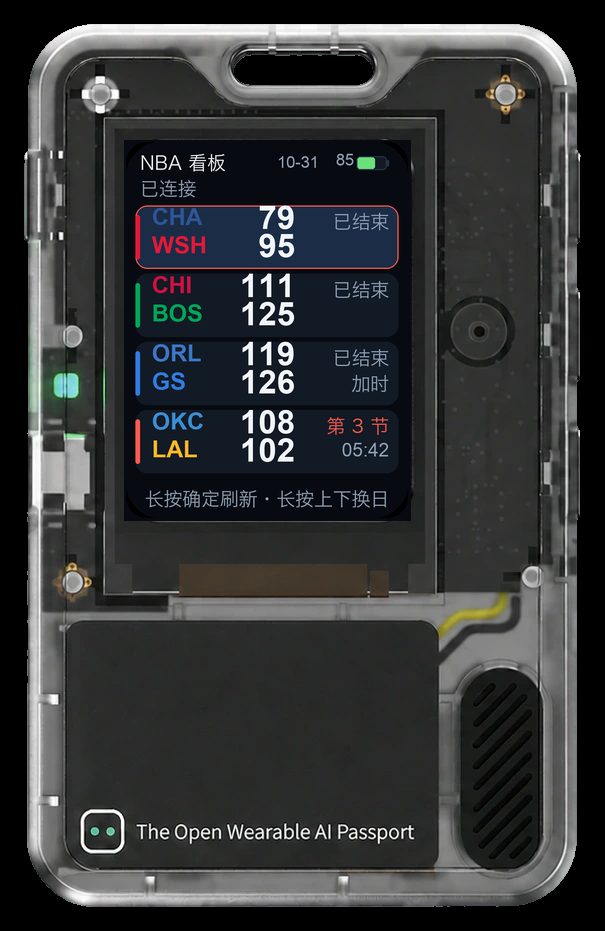
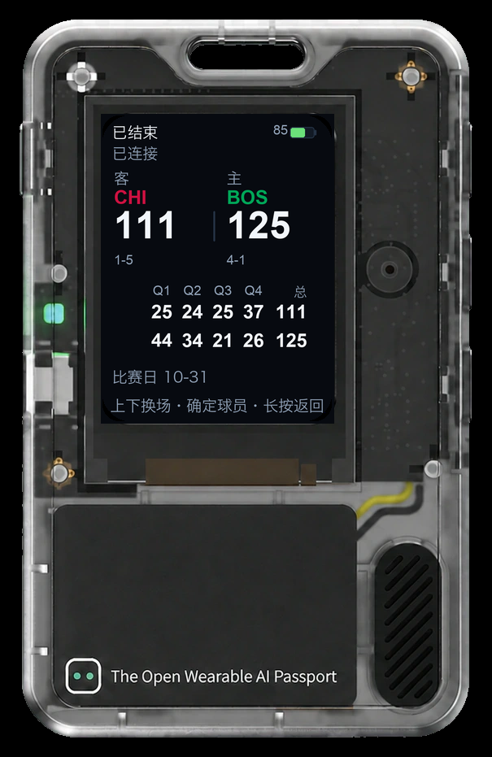
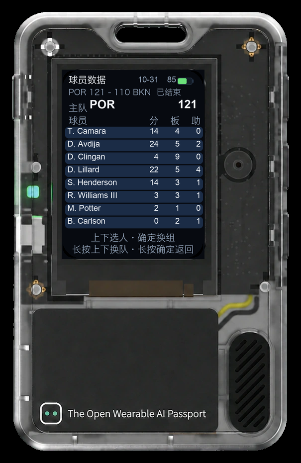
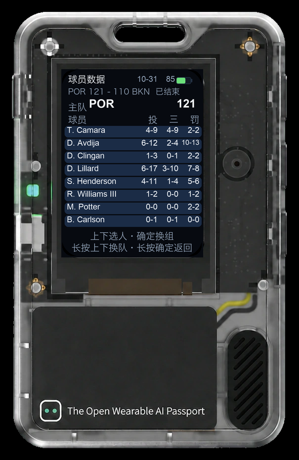
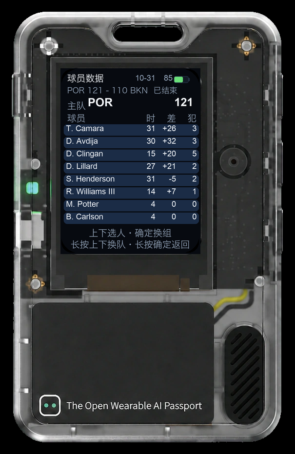
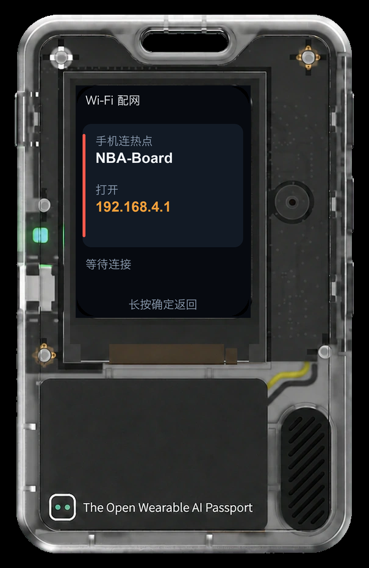
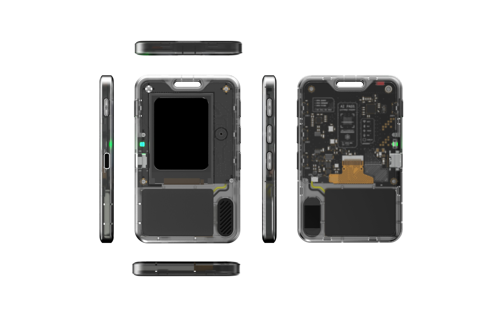

**Language:** [简体中文](README.zh_CN.md) | **English** — both editions are kept in sync.

> **Two README editions:** [简体中文](README.zh_CN.md) and English, with the same
> screen tour, setup steps, control table and build instructions.

<p align="center">
  
</p>

# NBA WatchBoard

A pocket NBA game-day scoreboard for the FoloToy AI Passport. It pulls a whole
day of games onto a 240x320 screen, then lets you drill from the score list into
quarter-by-quarter results and per-player box scores using just three buttons.

> **About the images.** The panel has no framebuffer read-back, so these are
> **layout-accurate illustrations, not photographs of a running device**.
> `tools/render_screens.py` paints every screen from the exact coordinates,
> colors and strings in `main/nba_ui.c`, fills it with the sample data in
> `tests/fixtures/`, and composites it into the product render at
> `docs/brand/ai-passport-front.png`. Swap in real device photos any time.

## What you get

- **Up to 16 games per day**, with team-colored abbreviations, scores and live
  status. If today has no games, the board walks forward to the next slate
  instead of showing an empty screen.
- **Three levels of detail**: overview, per-quarter breakdown (Q1-Q4 plus the
  final total), and a box score with four sliding stat groups per team.
- **Flip through dates** without re-entering the list. Past and future slates
  fetch immediately; the current day's results stay in RAM when Wi-Fi drops.
- **Adaptive refresh** instead of a fixed 60-second timer: live games poll
  often, finished games back off to a long idle window. Wi-Fi power saving is
  disabled only during an HTTP fetch, then restored.
- **Four saved Wi-Fi networks** that rotate automatically. If all of them fail,
  the board reopens its setup hotspot on its own.
- **Typographic care on a tiny screen**: long surnames and two-digit/two-digit
  shooting values such as `10-13` drop through 14 / 12 / 10 px fonts until they
  fit, so surnames never collapse to an initial and numbers never lose a digit.
- A hand-built 83-glyph Chinese font subset for the UI, so labels such as
  `球员数据` and `长按确定返回` render as real characters instead of boxes.

## Screen tour

<table>
<tr>
<td align="center"><br><b>Overview</b><br>Four games at a time; a red outline marks the selection and a red accent marks a live game.</td>
<td align="center"><br><b>Game detail</b><br>Big scores, records, Q1-Q4 and a separate total column that fits three digits.</td>
<td align="center"><br><b>Players: PTS / REB / AST</b><br>Eight rows per screen, one team at a time.</td>
</tr>
<tr>
<td align="center"><br><b>Players: FG / 3PT / FT</b><br>Compound values such as <code>10-13</code> stay fully visible.</td>
<td align="center"><br><b>Players: MIN / +/- / PF</b><br>Signed plus-minus values such as <code>+32</code>.</td>
<td align="center"><br><b>Wi-Fi setup</b><br>Hotspot name and address, shown only when needed.</td>
</tr>
</table>

Raw 240x320 renders (without the device frame) are next to each composite in
[docs/screens/](docs/screens/), and the six-up overview is
[docs/screens/screens-grid.png](docs/screens/screens-grid.png).

The board itself is a FoloToy AI Passport: a transparent wearable with a round
corner screen and three buttons on one ADC pin.

<p align="center">
  
</p>

The [cover illustration](docs/screens/cover-illustration.jpg) used for the
community listing is an AI-generated concept artwork, not a photo of the UI.

## First-time setup

1. Power on with no saved Wi-Fi. The board opens the setup screen by itself.
2. On a phone or laptop, join the open hotspot `NBA-Board`.
3. Open `http://192.168.4.1` in a browser.
4. Enter the network name and password, then submit. On success the page says
   `已连接,凭据已保存` and the hotspot closes by itself.
5. The board reloads the scoreboard. If it says `连接失败`, tap `重新填写` and
   try again; the previous settings are left untouched.

Only 2.4 GHz networks work (ESP32-C3). A network that requires a web login
(campus or hotel captive portal) cannot be used: the board has no browser, so
it cannot complete that login. Whitelist the device on the portal or use a
phone hotspot instead. To change networks later, use the serial `wifi`
commands below; after a saved network stays unreachable for about 90 seconds,
the board reopens the hotspot automatically.

## Controls

| Screen | Short press | Long press |
| --- | --- | --- |
| Overview | Up / Down move the selection, OK opens game detail | OK refreshes now, Up / Down step one day back / forward |
| Game detail | Up / Down switch to the previous / next game, OK opens players | OK returns to overview |
| Players | Up / Down move the cursor, OK slides in the next stat group | Up / Down switch team, OK returns to detail |
| Wi-Fi setup | (no input; the password is typed on the phone) | OK exits, or reopens the hotspot when there are no credentials |

Each screen prints only the non-obvious gestures at the bottom, for example
`长按确定刷新·长按上下换日` on the overview and `上下选人·确定换组` on the
players page. After 30 seconds idle the screen dims; any key wakes it.

## How it behaves

- **Data source.** ESPN's public scoreboard (`limit=16`) and summary JSON,
  parsed as a token stream so a 270 KB response never needs a full in-memory
  DOM. These endpoints are unofficial and may change.
- **Refresh window.** Live games refresh in tens of seconds, games that have
  not started use a longer window, and an all-finished slate falls back to a
  15-minute idle check. There is no fixed 60-second loop.
- **Offline.** A failed fetch never clears the last good board. Switching to
  another date triggers a fresh fetch right away.
- **Power.** Wi-Fi uses minimum-modem power saving at rest and switches to full
  performance only around the HTTP request.
- **Multi-network.** Four NVS slots, tried in order; only a network that
  actually obtains an IP is remembered as the last good one.

The full design notes, including why the total column is wider than the quarter
columns and why names are never reordered, live in
[docs/apps/nba-board.md](docs/apps/nba-board.md) (and its
[Chinese edition](docs/apps/nba-board.zh_CN.md)).

## Build and flash

You need ESP-IDF 5.5.x with the ESP32-C3 target and the component manager
dependencies from `dependencies.lock`. From the repository root:

```sh
idf.py set-target esp32c3
idf.py build
```

First flash on a blank device (merges bootloader, partition table and app):

```sh
idf.py merge-bin -o build/FoloToy-AI-Passport-full.bin
python -m esptool --chip esp32c3 -b 460800 write_flash 0x0 build/FoloToy-AI-Passport-full.bin
```

For later iterations, **write only the app partition**. A full merge image
written at `0x0` erases the NVS region and deletes the saved Wi-Fi credentials:

```sh
python -m esptool --chip esp32c3 -b 460800 write_flash 0x10000 build/FoloToy-AI-Passport.bin
```

The serial console uses the ESP32-C3 USB-Serial-JTAG port (115200 8N1):

```text
nba> wifi -l                    # list saved networks
nba> wifi <SSID> <password>     # add or replace a network
nba> wifi -d <SSID>             # forget a network
nba> key ok|up|down|long-ok|long-up|long-down
```

Validation (host unit tests, repository checks, font coverage, firmware build):

```sh
bash tools/validate.sh --static
bash tools/validate.sh --firmware
```

To regenerate the README previews after changing the UI:

```sh
python3 -m pip install pillow
python3 tools/render_screens.py
```

## Repository layout

| Path | Contents |
| --- | --- |
| `main/nba_app.c` | Refresh scheduling, date strategy, network state machine |
| `main/nba_api.c`, `main/nba_json.c`, `main/nba_parse.c` | HTTP fetch and streaming JSON parsing |
| `main/nba_box.c` | Player box-score parsing |
| `main/nba_ui.c` | All four LVGL screens and layout constants |
| `main/wifi_mgr.c`, `main/nba_prov.c` | Four-slot Wi-Fi manager and captive setup portal |
| `assets/fonts/` | Generated Chinese subset font |
| `tests/` | Host unit tests and ESPN response fixtures |
| `docs/screens/` | Generated README illustrations |
| `docs/apps/nba-board.md` | Full design notes |

The baseline hardware demo sources remain in `main/demo_*.c` as BSP usage
examples; they are no longer compiled into this firmware.

## Credits

Built on the [FoloToy AI Passport](docs/README.md) open firmware template.
Scores and box scores come from ESPN's public endpoints. Released under the
[MIT License](LICENSE).
