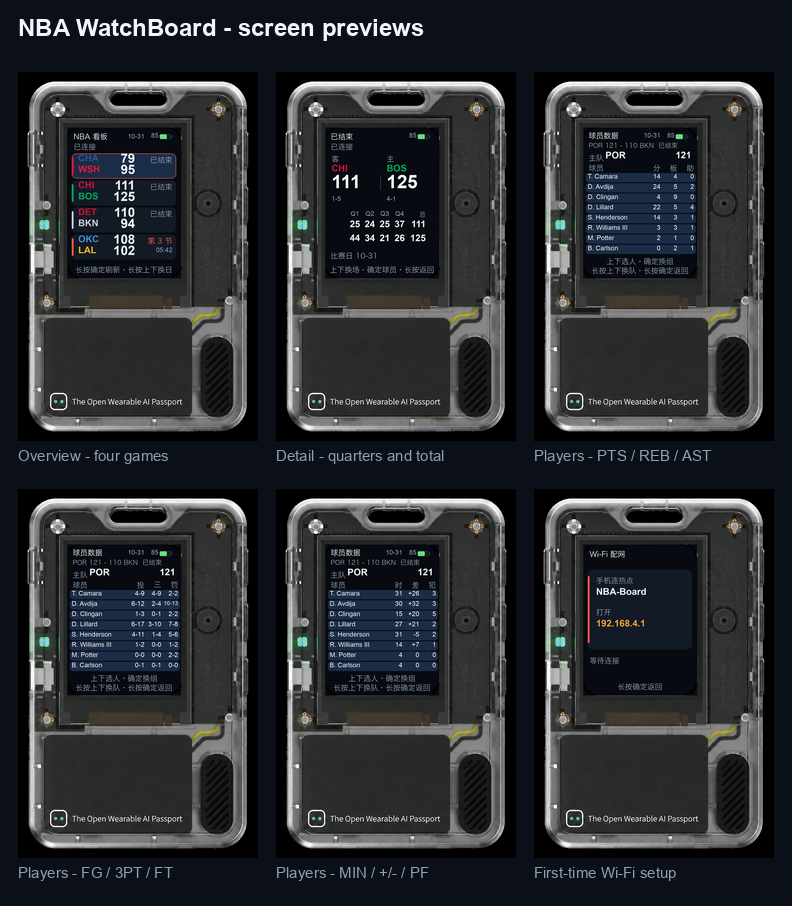
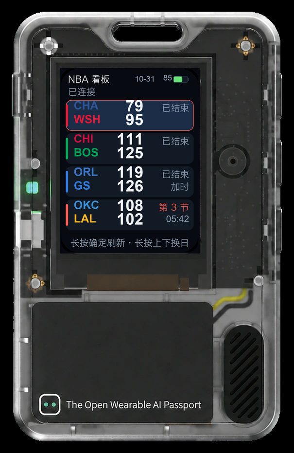
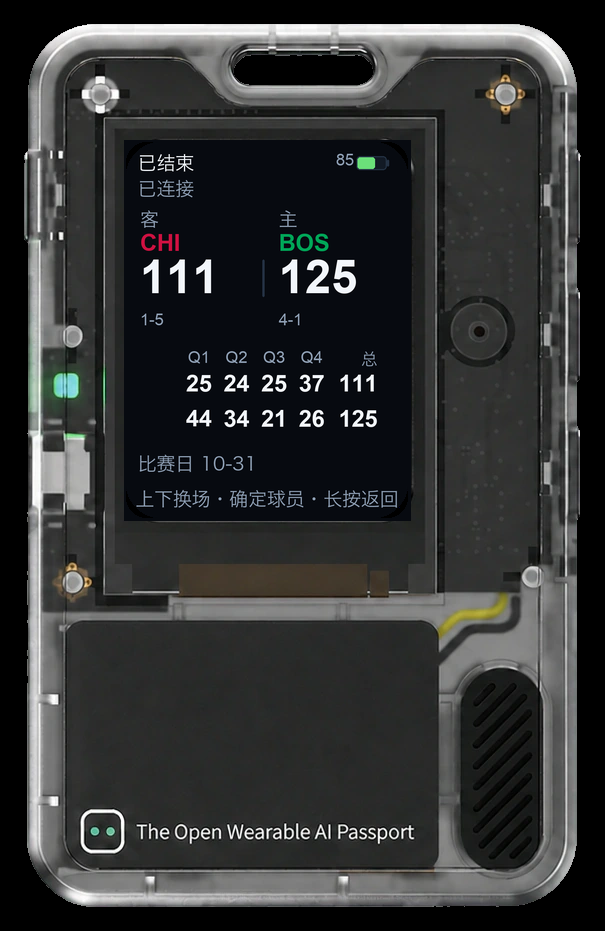
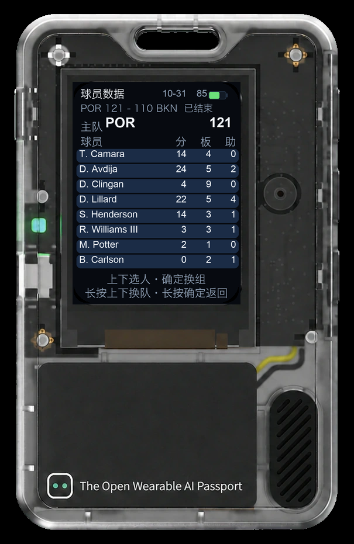
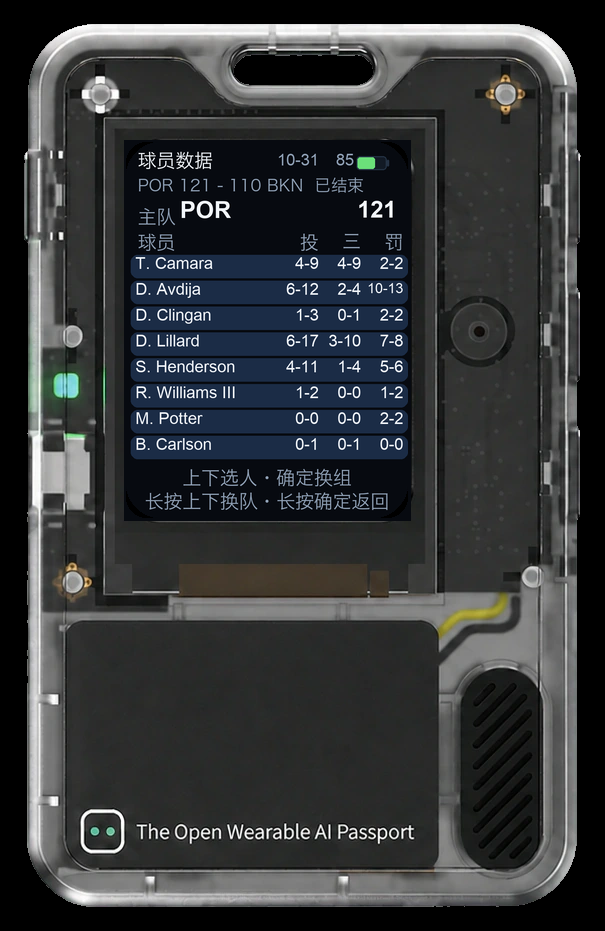
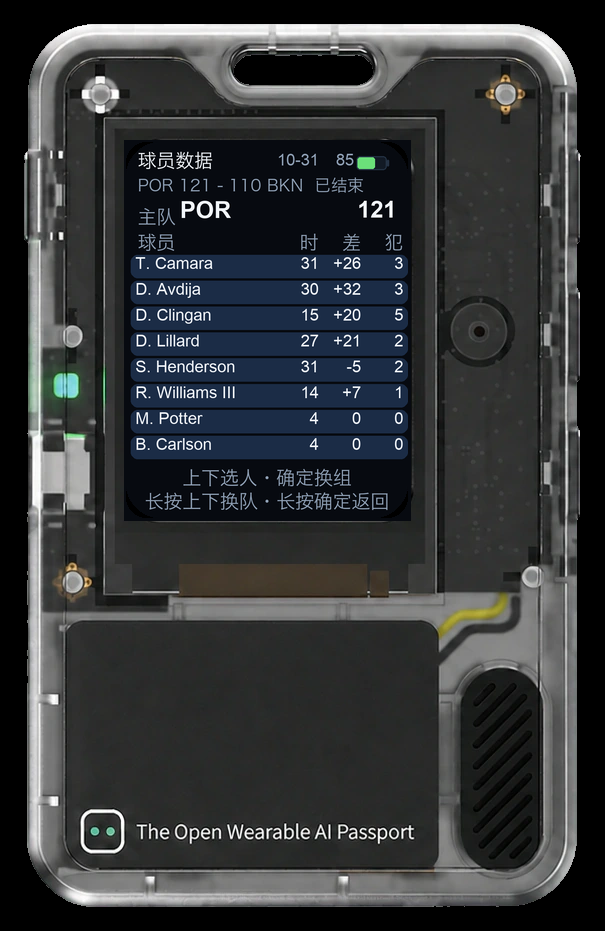
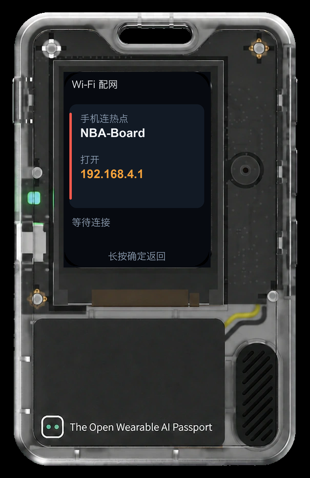
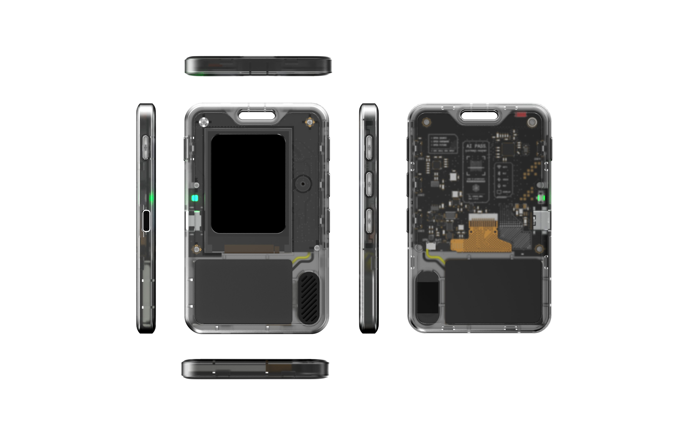

**语言：** [English](README.md) | **简体中文** —— 两份内容同步维护。

> **中英双版 README**：本页为中文版，[English](README.md) 内容一致；
> 六屏图库、首次配网、按键表、构建与烧写说明都齐全。

<p align="center">
  
</p>

# NBA 比赛看板

把 FoloToy AI Passport 变成随身记分牌：在 240×320 的小屏幕上拉取一个 NBA 比赛日的全部比分，再用三颗按键逐层看分节得分和球员技术统计。

> **关于配图。** 这块屏幕没有显存回读接口，所以下面是**按源码布局还原的界面示意图，不是实机照片**。
> `tools/render_screens.py` 按 `main/nba_ui.c` 里的真实坐标、配色和文案逐屏绘制，
> 数据取自 `tests/fixtures/` 的样例，再合成进 `docs/brand/ai-passport-front.png` 的产品图。
> 有实机照片时直接替换即可。

## 玩法特色

- **每天最多 16 场**：球队色缩写、比分、进行中状态一屏 4 行。当天没比赛会自动往后找下一个比赛日，不会开屏就是空白。
- **三级页面**：总览 → 单场详情（Q1–Q4 + 独立总分列）→ 球员数据（每队四组数据，按确定键滑入切换）。
- **按天翻页**：长按上下直接换比赛日，历史与未来赛程立即抓取；断网时本次开机查到的比分仍留在内存里。
- **自适应刷新**：不设 60 秒固定轮询。进行中的比赛刷得勤，未开赛的拉长间隔，当天全部结束后落到 15 分钟兜底；Wi-Fi 省电只在 HTTP 抓取期间临时关闭，抓完立刻恢复。
- **可存 4 个 Wi-Fi**：按顺序轮换，只有真正拿到 IP 的网络才会记为「上次可用」；全部连不上时自动重开配网热点。
- **小屏排版讲究**：长姓和 `10-13` 这类「两位数-两位数」投篮数据会在 14 / 12 / 10 px 三档字号里挑一个放得下的，姓不会被砍成首字母，数字也不会少一位。
- 界面中文用自建的 83 字子集字体，`球员数据`、`长按确定返回` 都是真字形，不会显示成方框。

## 界面一览

<table>
<tr>
<td align="center"><br><b>总览</b><br>一屏 4 场；红框是选中，红色竖条是进行中。</td>
<td align="center"><br><b>单场详情</b><br>大字比分、战绩、Q1–Q4，以及容得下三位数的总分列。</td>
<td align="center"><br><b>球员：分 / 板 / 助</b><br>一屏 8 行，一次看一支球队。</td>
</tr>
<tr>
<td align="center"><br><b>球员：投 / 三 / 罚</b><br><code>10-13</code> 这类复合值两头都完整。</td>
<td align="center"><br><b>球员：时 / 差 / 犯</b><br><code>+32</code> 这类带符号的正负值。</td>
<td align="center"><br><b>Wi-Fi 配网</b><br>只在需要时出现，写清热点名和地址。</td>
</tr>
</table>

每张设备图旁边还有不带外壳的 240×320 原图，都在 [docs/screens/](docs/screens/)；六图总览是
[docs/screens/screens-grid.png](docs/screens/screens-grid.png)。

硬件本体是 FoloToy AI Passport：透明外壳、圆角屏幕，三颗按键共用一个 ADC 引脚。

<p align="center">
  
</p>

社区玩法用的 [封面插画](docs/screens/cover-illustration.jpg) 是 AI 生成的概念示意，不是界面实拍。

## 首次上手

1. 没有保存过 Wi-Fi 时开机，设备自动进入配网页。
2. 用手机或电脑连接开放热点 `NBA-Board`。
3. 浏览器打开 `http://192.168.4.1`。
4. 填入网络名称和密码并提交。成功后网页显示「已连接，凭据已保存」，热点自动关闭。
5. 设备自动回到看板。若显示「连接失败」，点「重新填写」重试，原配置不会被改动。

只支持 2.4 GHz 网络（ESP32-C3）。需要网页认证的校园网 / 酒店网用不了：设备没有浏览器，完成不了认证，需在认证页给设备放行，或改用手机热点。之后换网络可用下面的串口 `wifi` 命令；已保存的网络约 90 秒连不上，设备会自动重开配网热点。

## 按键

| 页面 | 短按 | 长按 |
| --- | --- | --- |
| 总览 | 上/下移动选择，确定进入详情 | 确定立即刷新，上/下切到前/后一个比赛日 |
| 详情 | 上/下切换比赛，确定进入球员页 | 确定返回总览 |
| 球员 | 上/下移动光标，确定滑到下一组数据 | 上/下切换球队，确定返回详情 |
| 配网 | 不收输入（密码在手机上敲） | 确定退出；没有凭据时再长按可重开热点 |

屏幕底部只提示猜不到的手势，例如总览的「长按确定刷新·长按上下换日」、球员页的「上下选人·确定换组」。30 秒无操作屏幕变暗，任意按键唤醒。

## 运行机制

- **数据来源**：ESPN 公开的 scoreboard（`limit=16`）与 summary 接口。用流式 token 解析，270 KB 的响应不需要整棵 DOM 常驻内存。接口非官方，字段可能变动。
- **刷新窗口**：进行中的比赛几十秒一次，未开赛的更长，当天全部结束后 15 分钟兜底；没有固定 60 秒循环。
- **断网**：抓取失败绝不覆盖上一份好数据；切换比赛日会立刻重新抓取。
- **功耗**：平时 Wi-Fi 走最小调制解调器省电，只在 HTTP 请求前后短暂切到全速。
- **多网络**：NVS 四个槽位按顺序试，只有真正拿到 IP 的才记为上次可用。

完整设计说明（为什么总分列比节次列宽、为什么姓名绝不重排序）见
[docs/apps/nba-board.zh_CN.md](docs/apps/nba-board.zh_CN.md)，英文版见
[docs/apps/nba-board.md](docs/apps/nba-board.md)。

## 构建与烧写

需要 ESP-IDF 5.5.x（esp32c3）与 `dependencies.lock` 里的组件依赖。在仓库根目录：

```sh
idf.py set-target esp32c3
idf.py build
```

空白设备首次烧写（合并 bootloader、分区表与 app）：

```sh
idf.py merge-bin -o build/FoloToy-AI-Passport-full.bin
python -m esptool --chip esp32c3 -b 460800 write_flash 0x0 build/FoloToy-AI-Passport-full.bin
```

后续迭代**只烧 app 分区**：从 `0x0` 写合并镜像会擦掉 NVS，已保存的 Wi-Fi 凭据会一起丢失。

```sh
python -m esptool --chip esp32c3 -b 460800 write_flash 0x10000 build/FoloToy-AI-Passport.bin
```

串口控制台走 ESP32-C3 的 USB-Serial-JTAG（115200 8N1）：

```text
nba> wifi -l                    # 列出已保存网络
nba> wifi <SSID> <密码>         # 添加或覆盖一个网络
nba> wifi -d <SSID>             # 删除一个网络
nba> key ok|up|down|long-ok|long-up|long-down
```

门禁检查（主机单测、仓库检查、字体覆盖、固件构建）：

```sh
bash tools/validate.sh --static
bash tools/validate.sh --firmware
```

改了界面后重新生成 README 配图：

```sh
python3 -m pip install pillow
python3 tools/render_screens.py
```

## 目录

| 路径 | 内容 |
| --- | --- |
| `main/nba_app.c` | 刷新调度、日期策略、网络状态机 |
| `main/nba_api.c`、`main/nba_json.c`、`main/nba_parse.c` | HTTP 抓取与流式 JSON 解析 |
| `main/nba_box.c` | 球员技术统计解析 |
| `main/nba_ui.c` | 四个 LVGL 页面与全部布局常量 |
| `main/wifi_mgr.c`、`main/nba_prov.c` | 四槽 Wi-Fi 管理与配网热点 |
| `assets/fonts/` | 生成的中文子集字体 |
| `tests/` | 主机单测与 ESPN 响应夹具 |
| `docs/screens/` | 生成的 README 配图 |
| `docs/apps/nba-board.zh_CN.md` | 完整设计说明 |

基线硬件自检 demo 仍保留在 `main/demo_*.c` 作为 BSP 用法参考，已不再编进本固件。

## 致谢

基于 [FoloToy AI Passport](docs/README.md) 开源固件模板开发；比分与球员数据来自 ESPN 公开接口。
按 [MIT License](LICENSE) 发布。
